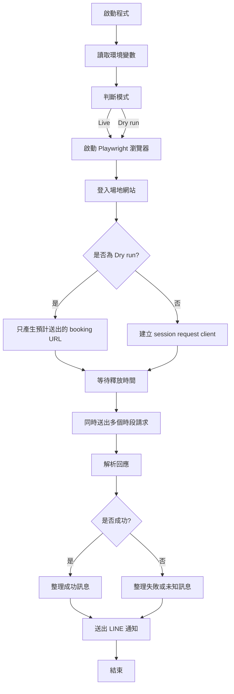
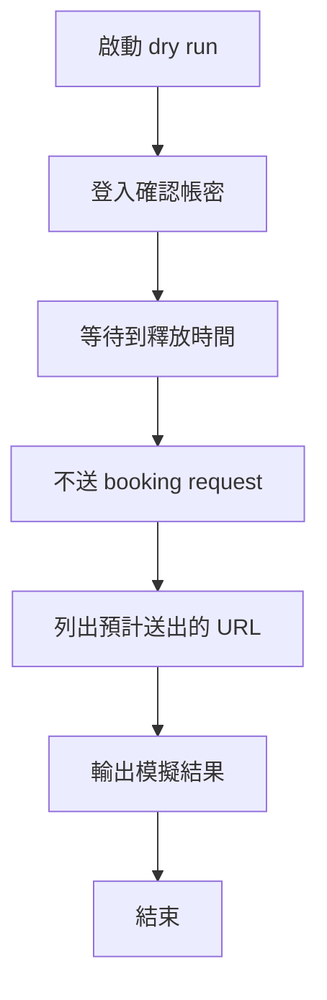

# 重構說明

## 排程更新：提前一分鐘準備

排程以 Asia/Taipei 執行。週三 23:59 啟動中正與中山的登入準備，週四 00:00 送出預約；週四 23:59 啟動大安的登入準備，週五 00:00 送出預約。

登入、場地 ID 解析與 request client 建立都在等待前完成。各場館共用同一個 releaseAt，準備完成後等待該時間才送出請求；如果準備超過整點，完成後立即送出。目標日期以 releaseAt 的台北日期加 7 或 13 天計算，避免跨午夜少算一天。原本額外的 120ms 延遲已移除。

cron 服務仍需事先透過 npm start 持續執行；23:59 觸發的是預約任務。手動執行維持立即執行，dry run 會登入與列出計畫但不等待午夜。

這份文件是在說明這次把搶場 bot 從「單檔、硬編碼、脆弱解析」重構成「可測、可切換模式、責任分離」的過程。

我會盡量用工程角度來講，不只說「改了什麼」，也說「為什麼要這樣改」和「有哪些取捨」。

## 先講結論

重構後的核心目標有三個：

1. 讓搶場流程更快、更穩
2. 讓每個功能都有明確責任，方便維護與測試
3. 讓你可以先用 `dry run` 驗流程，再切換到正式模式

這次的改寫不是單純「把程式碼寫得比較漂亮」，而是把它從「只能勉強跑」變成「可以理解、可以驗證、可以擴充」。

## 流程圖

下面這張圖先把整體流程畫出來。你可以先看圖，再回頭看後面的拆解，會更容易把每個檔案和責任對上。



如果你想更細一點看，`dry run` 的分支可以再想成這樣：



---

## 原本的問題

原始版本有幾個明顯瓶頸：

1. 搶場邏輯寫在同一個檔案裡，登入、等待、送請求、判斷結果、通知都混在一起。
2. 成功與失敗的判斷很依賴字串切片，網站 HTML 稍微變動就容易壞。
3. 送出請求的時間控制不夠精準，甚至曾經有「太早送」或「流程干擾排程」的問題。
4. Python 與 JS 兩套實作並存，會讓維護成本翻倍。
5. 通知方式與 `.env` 裡的實際變數名稱不一致。

簡單說，原本的程式比較像一條「能跑但不好修」的直線；現在改成多個小積木，雖然檔案變多，但每塊都比較清楚。

---

## 重構後的流程總覽

現在正式流程大致是：

1. 讀取環境變數
2. 啟動 Playwright 瀏覽器
3. 登入場地網站
4. 建立 session 後端 request client
5. 等到設定的搶場時間
6. 針對每個時段同時送出請求
7. 解析結果
8. 回報 LINE 通知

如果是 `dry run`：

1. 讀取環境變數
2. 啟動瀏覽器並登入，確認帳密可用
3. 等到設定時間
4. 不真的送 booking request
5. 只印出預計會送出的 URL 和模擬結果

---

## 每一步是怎麼拆的

### 1. 把 Python 刪掉，只保留 JS

#### 做了什麼

- 移除 `app.py`
- 讓整個專案只剩一套主流程：`app.js`

#### 為什麼這樣做

原本 JS 和 Python 都在做類似的事，但兩邊邏輯不完全一樣：

- JS 用 Playwright
- Python 用 Selenium + requests

這會導致：

- 你要維護兩份相似程式
- 一邊改了，另一邊可能忘了同步
- 出問題時很難判斷到底該修哪一份

#### 取捨

把 Python 拿掉的代價是：

- 少了一個備援實作

但換來的是：

- 維護面大幅簡化
- 之後 debug 只需要看一條主線

對這種單一用途 bot 來說，這個取捨是值得的。

---

### 2. 把「等待時間」獨立到 `utils/get-date.js`

#### 做了什麼

`utils/get-date.js` 現在負責：

- `getToday()`
- `getNextTargetDate()`
- `getReleaseMoment()`
- `waitUntil()`

#### 為什麼這樣做

時間相關邏輯很容易分散在各處，尤其是：

- 日期格式
- 時區
- 何時才是真正要送出的那一刻

把這些抽出去後有兩個好處：

1. `app.js` 不會被時間細節淹沒
2. 時間邏輯可以單獨測、單獨改

#### 思維

我把「業務流程」和「時間工具」分開。

- 業務流程：登入、發請求、判斷成功失敗
- 時間工具：今天幾號、目標日期、何時開搶、怎麼等到那一刻

這樣做是典型的「單一責任」拆法。

#### 取捨

`waitUntil()` 裡有一小段 busy wait。

這不是最省 CPU 的做法，但我刻意保留它，原因是：

- 搶場這種情境重點是「精準到點送出」
- 在最後幾十毫秒內，比起省 CPU，更重要的是降低排程抖動

這是明確的效率與精準度取捨。

---

### 3. 把 booking URL 與回應解析拆到 `utils/booking.js`

#### 做了什麼

`utils/booking.js` 負責：

- 組 booking URL
- 組 redirect URL
- 從 HTML 中抓 redirect path
- 判斷回應屬於 success / redirect / failure / unknown

#### 為什麼這樣做

原本在 `app.js` 裡有大量這種邏輯：

- 用字串拼 URL
- 用 `substring()` 切 redirect 路徑
- 用 `indexOf()` 找「預約成功」

這種寫法的問題是：

- 很脆
- 很難測
- 很難知道哪一段壞了

拆成 `booking.js` 後，這件事變成「可測的純邏輯」。

#### 思維

我把「外部網站協定」當成一個獨立模組。

因為 booking 網站本質上是在跟你說：

- 這個 URL 怎麼組
- 回來的 HTML 長什麼樣
- 有沒有 redirect

這類東西最適合被包起來，讓主流程不直接碰細節。

#### 取捨

我沒有一開始就做成完整 HTML parser 或 DOM parser，而是先用「夠穩、夠輕」的正規表示式和關鍵字判斷。

原因是：

- 這個網站的格式看起來相對固定
- 過度工程化會讓維護成本變高
- 真正需要的是「足夠穩定」，不是「學術上最漂亮」

這是「工程實用性」優先的取捨。

---

### 4. 把主流程改成 `app.js` 的 orchestrator

#### 做了什麼

`app.js` 現在比較像一個協調者，不是所有細節都自己做。

它負責：

- 讀環境變數
- 決定是不是 dry run
- 啟動瀏覽器
- 登入
- 取得 session
- 等待釋放時間
- 同時送出多個時段請求
- 彙整結果
- 發 LINE 通知

#### 為什麼這樣做

這種寫法的好處是：

- 你一看 `app.js` 就知道整體流程
- 細節都在 helper 模組裡
- 新增功能時比較不會把主流程弄爆

#### 思維

我把 `app.js` 視為「流程編排」而不是「工具箱」。

也就是說：

- `app.js` 只應該回答「先做什麼、再做什麼」
- 不應該塞太多「怎麼做」的細節

這樣之後你要改策略，比較容易定位。

#### 取捨

檔案數量增加了。

但這不是壞事，因為：

- 檔案變多不代表複雜
- 亂塞在一起才是真的複雜

對長期維護來說，清楚比短更重要。

---

### 5. 把並行送單改成 `Promise.allSettled`

#### 做了什麼

每個時段的 booking 請求仍然是同時送出，但結果收集改成 `Promise.allSettled()`。

#### 為什麼這樣做

如果其中一個時段失敗，不希望整個流程直接炸掉。

`Promise.all()` 的特性是：

- 任何一個 reject，整包就 fail

`Promise.allSettled()` 的特性是：

- 每個 promise 的成功失敗都會留下來
- 你可以知道哪個成功、哪個失敗

對搶場來說，這個特性非常重要，因為你通常會同時搶多個時段。

#### 取捨

`allSettled` 比 `all` 多一點結果整理的工作。

但這個成本很小，換來的是：

- 更完整的回報
- 單一時段失敗不會連累其他時段

這是很值得的取捨。

---

### 6. 新增 `dry run` 模式

#### 做了什麼

加入兩種啟動方式：

- `npm run dry-run`
- `DRY_RUN=1 node app.js`

`dry run` 會：

- 登入
- 等到時間
- 產生預計送出的 URL
- 不真的送 booking request
- 不送 LINE 通知

#### 為什麼這樣做

這種 bot 最大的風險不是「跑不起來」，而是：

- 你不確定流程是不是正確
- 你不確定時間是不是抓對
- 你不確定登入有沒有成功

`dry run` 讓你可以在正式搶場前先做一輪驗證。

#### 思維

`dry run` 是一種「把風險延後到最後一刻再承擔」的設計。

你可以先確認：

- 帳密沒問題
- 時間沒問題
- URL 組法沒問題
- 程式啟動沒問題

最後真的要送 booking 的那一步才切到 live。

#### 取捨

`dry run` 不是完全不做事。

它仍然會登入，這是刻意保留的，因為：

- 只看參數不登入，很多問題抓不出來
- 實際登入才能驗證帳密和網站狀態

所以這裡的取捨是：

- 保留足夠多的真實流程來驗證
- 拿掉真正會造成副作用的動作

---

### 7. 修正通知方式

#### 做了什麼

`utils/line-message.js` 改成：

- 讀 `LINE_NOTIFY_PERSONAL_TOKEN`
- 呼叫 LINE Notify API

#### 為什麼這樣做

原本程式裡有：

- `LINE_MESSAGE_PERSONAL_TOKEN`
- 但實際 API 用法更像 LINE Notify，而不是 bot push

這會讓人很容易搞混。

現在我讓它跟你 `.env` 裡真實存在的變數對齊，並且把行為固定下來。

#### 取捨

我有保留 `LINE_MESSAGE_PERSONAL_TOKEN` 作為 fallback。

原因是：

- 不想讓你環境設定立刻壞掉
- 讓舊設定還能暫時沿用

這是一個向後相容的折衷。

---

### 8. 新增單元測試

#### 做了什麼

新增 `[tests/booking.test.js](/Users/leesteve/Personal/badminton-bot/tests/booking.test.js:1)`，覆蓋：

- booking URL 組裝
- redirect URL 組裝
- 成功標記辨識
- redirect script 辨識

#### 為什麼這樣做

這次拆出去的邏輯，最值得測的就是：

- URL 有沒有組對
- 回應解析有沒有抓到正確狀態

這些都屬於「純函式」，非常適合測試。

#### 思維

我的原則是：

- 對外部網站的真實請求，不要放進單元測試
- 對容易壞的純邏輯，一定要有測試

這樣測試才不會慢、脆、還難維護。

#### 取捨

這次測試沒有做端到端真搶場。

原因是：

- 端到端測試會牽涉真實網站、帳號、時機
- 成本高，且不穩定

所以我選擇把最核心、最容易出 bug 的部分先測住。

---

## 你可以從這次重構學到的思路

### 1. 先切責任，不要急著「優化」

很多人寫自動化 bot 時，會先想：

- 怎麼更快
- 怎麼更短
- 怎麼更少行

但真正有效的順序通常是：

1. 先把責任切清楚
2. 再把容易壞的地方抽出來
3. 最後才談速度優化

因為如果責任本來就混在一起，你根本不知道是在優化什麼。

---

### 2. 把「規則」和「執行」分開

像這次的例子：

- 規則：幾天後的日期、什麼時間搶、哪些時段要打
- 執行：怎麼登入、怎麼發 request、怎麼解析結果

一旦分開，你的主流程就會更像劇本，而不是一堆工具混雜。

---

### 3. 先寫可測的純邏輯

最值得抽出去的東西通常是：

- 字串組裝
- URL 組裝
- 狀態解析
- 日期計算

因為這些東西最容易被忽略，但一壞就整條流程壞掉。

---

### 4. 不要過早追求「最漂亮」

我這次沒有把 HTML 解析做成很重的抽象，也沒有把乾跑模式做成超泛用的框架。

原因是：

- 這個專案目前是單一用途
- 過度抽象會讓你每次改一點都很痛

所以我選擇的是「夠穩、夠清楚、夠容易改」。

---

## 目前的檔案分工

- `[app.js](/Users/leesteve/Personal/badminton-bot/app.js:1)` 主流程協調
- `[utils/get-date.js](/Users/leesteve/Personal/badminton-bot/utils/get-date.js:1)` 時間與等待工具
- `[utils/booking.js](/Users/leesteve/Personal/badminton-bot/utils/booking.js:1)` booking 協定與解析
- `[utils/line-message.js](/Users/leesteve/Personal/badminton-bot/utils/line-message.js:1)` 通知
- `[tests/booking.test.js](/Users/leesteve/Personal/badminton-bot/tests/booking.test.js:1)` 單元測試
- `[cron.js](/Users/leesteve/Personal/badminton-bot/cron.js:1)` 排程入口

---

## 使用方式

正式模式：

```bash
npm run start
```

乾跑模式：

```bash
npm run dry-run
```

或：

```bash
DRY_RUN=1 node app.js
```

---

## 最後的總結

這次重構最大的價值，不只是「讓它能跑」，而是讓整體思考方式變成：

- 哪些是流程
- 哪些是工具
- 哪些是可測邏輯
- 哪些是外部副作用

這種拆法會讓你以後加功能時更不容易失控，也比較知道問題到底出在哪一層。

如果你願意，下一步我也可以幫你把這份內容再整理成：

1. 更適合放在 repo 的 `README` 版本
2. 更偏教學筆記的版本
3. 直接轉成 `docs/refactor-notes.md` 並補目錄連結
